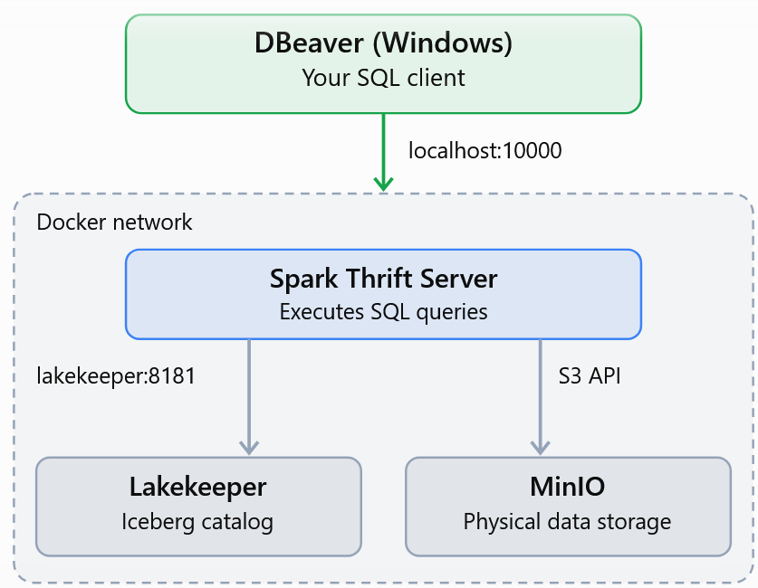

Keep DBeaver connected to localhost:10000. The Lakekeeper URL serves a different purpose.
Your lakehouse has several services, each with its own address.

## Which address should you use?

Address Purpose
jdbc:hive2://localhost:10000 DBeaver SQL connection
http://lakekeeper:8181/catalog Internal Spark-to-Lakekeeper connection
localhost:8181/ui/ Lakekeeper browser interface
localhost:9001 MinIO storage management
localhost:8081 Flink dashboard
localhost:3030 Lakehouse web applica
